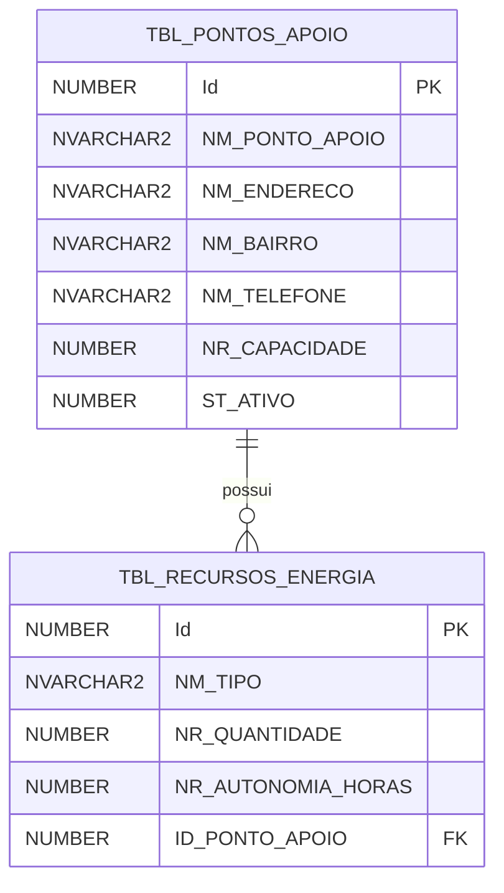

# API de Pontos de Apoio da Tomada Vital

API REST em ASP.NET Core 8 para o cadastro dos pontos de apoio com energia de reserva e dos recursos de energia de cada um.

## O problema

Pacientes eletrodependentes precisam de um aparelho elétrico ligado o tempo todo para viver — concentrador de oxigênio, ventilador, aspirador de secreção, bomba de infusão. Quando falta luz, esses aparelhos passam a funcionar na bateria, e a família tem pouco tempo para agir. Apagões grandes em São Paulo mostram o tamanho do problema: em 10/12/2025, 4,4 milhões de clientes da Enel ficaram sem energia; em 11/10/2024, foram 3,1 milhões de clientes (número corrigido pela Enel em 17/10/2024). Nesses momentos, a família precisa saber rapidamente para onde levar o paciente antes que a bateria do aparelho acabe.

## A solução Tomada Vital

A Tomada Vital é um dispositivo instalado na tomada do aparelho elétrico do paciente. Ele percebe a queda de energia e avisa pela rede celular. Uma API em Java recebe esse aviso e monta a fila de atendimento por tempo restante de bateria. Um aplicativo em Flutter mostra à família a situação da casa, o andamento do atendimento e os pontos de apoio. Esta API, em ASP.NET Core 8, é o módulo que guarda o cadastro dos pontos de apoio — locais com energia de reserva, como UBS com gerador, escola, centro comunitário e posto de bombeiros — e dos recursos de energia de cada um (gerador, nobreak, cilindro de oxigênio reserva). A solução se relaciona com os Objetivos de Desenvolvimento Sustentável da ONU 3 (Saúde e Bem-Estar), 9 (Indústria, Inovação e Infraestrutura), 11 (Cidades e Comunidades Sustentáveis) e 13 (Ação contra a Mudança Global do Clima).

**Importante:** o dispositivo mede a tomada, nunca o paciente. Não é um aparelho médico.

## Como esta API se liga ao resto

Esta API guarda os mesmos 4 locais que aparecem na tela "Pontos de apoio" do aplicativo Flutter da família. Hoje essa tela usa dados de exemplo dentro do próprio app; a integração do aplicativo com esta API é um próximo passo do projeto. Esta API é um módulo separado da API em Java, com banco de dados próprio no Oracle da FIAP. A API que vai para o Azure com Docker, no módulo de DevOps, é a de Java — esta API é obrigada a usar o Oracle da FIAP, então fica fora desse empacotamento.

## Integrantes

| Nome | RM | Turma |
|---|---|---|
| Diego Paulino | RM566841 | 2TDSPR |
| Guilherme Dabul | RM559901 | 2TDSPR |
| Renan Lima | RM568321 | 2TDSPR |
| Ryan Mazali | RM567168 | 2TDSPR |
| Thiago Alexandre | RM567486 | 2TDSPR |

## Tecnologias

- .NET 8
- ASP.NET Core Web API com controllers
- Entity Framework Core 8, com Migrations
- Oracle Database, via `Oracle.EntityFrameworkCore`
- Scalar, para a documentação interativa dos endpoints

## Diagrama das entidades



A chave estrangeira `ID_PONTO_APOIO` fica na tabela `TBL_RECURSOS_ENERGIA` e aponta para `TBL_PONTOS_APOIO.Id`; como ela é obrigatória, o EF Core criou a constraint com `ON DELETE CASCADE`, então apagar um ponto de apoio apaga junto os recursos de energia ligados a ele.

## Estrutura do projeto

| Arquivo / pasta | Papel |
|---|---|
| `PontosApoioApi.sln` | solução do Visual Studio |
| `PontosApoioApi.csproj` | projeto .NET 8 e os pacotes (EF Core, Oracle, Scalar, Swashbuckle) |
| `Program.cs` | monta a aplicação: conexão com o Oracle, controllers e a documentação |
| `appsettings.json` / `appsettings.Development.json` | configuração da aplicação; a connection string de verdade não fica aqui |
| `Properties/launchSettings.json` | perfis `http` e `https` para rodar a API localmente |
| `PontosApoioApi.http` | a carga dos 4 pontos e 5 recursos, e os testes manuais dos endpoints |
| `Models/PontoApoio.cs` | entidade do ponto de apoio, com as validações |
| `Models/RecursoEnergia.cs` | entidade do recurso de energia, com as validações |
| `Data/AppDbContext.cs` | o `DbContext`, o mapeamento das tabelas no Oracle e o relacionamento 1:N |
| `Controllers/PontoApoioController.cs` | CRUD dos pontos de apoio |
| `Controllers/RecursoEnergiaController.cs` | CRUD dos recursos de energia |
| `Controllers/ErroResposta.cs` | formato comum das respostas de erro (400 e 404) |
| `Migrations/` | a Migration gerada pelo EF Core (nunca editada à mão) |

## Como executar

**Pré-requisitos:**
- .NET 8 SDK
- Visual Studio 2022 ou 2026, ou apenas a linha de comando
- Uma conta de acesso ao Oracle da FIAP (usuário RM e senha)

**1. Clonar o repositório**

```powershell
git clone https://github.com/DiegoCPaulino/API-Tomada-Vital-Pontos-Apoio.git
```

**2. Configurar a connection string**

O `appsettings.json` deste repositório tem só um marcador (`SEU_RM` / `SUA_SENHA`), nunca a senha de verdade. A connection string real precisa ficar nos Segredos do Usuário (User Secrets) do Windows, fora da pasta do projeto.

- **Pelo Visual Studio:** clique com o botão direito no projeto `PontosApoioApi` → "Gerenciar Segredos do Usuário". Isso abre um `secrets.json` vazio; cole:

```json
{
  "ConnectionStrings": {
    "OracleConnection": "User Id=SEU_RM;Password=SUA_SENHA;Data Source=oracle.fiap.com.br:1521/ORCL;"
  }
}
```

- **Pela linha de comando:**

```powershell
dotnet user-secrets set "ConnectionStrings:OracleConnection" "User Id=SEU_RM;Password=SUA_SENHA;Data Source=oracle.fiap.com.br:1521/ORCL;" --project PontosApoioApi.csproj
```

Troque `SEU_RM` e `SUA_SENHA` pelos seus dados de acesso ao Oracle da FIAP.

**3. Aplicar as Migrations**

- **Pelo Console do Gerenciador de Pacotes (Visual Studio):**

```powershell
Update-Database
```

- **Pelo terminal:**

```powershell
dotnet tool install --global dotnet-ef --version 8.0.34
```

```powershell
dotnet ef database update --project PontosApoioApi.csproj
```

**4. Executar**

- No Visual Studio, com o projeto `PontosApoioApi` selecionado como projeto de inicialização: F5 no perfil `https`.
- Ou pelo terminal:

```powershell
dotnet run --project PontosApoioApi.csproj --launch-profile https
```

A documentação interativa abre em `/scalar/v1`.

**Atenção:** a pasta tem o `.sln` e o `.csproj` juntos. Rodar `dotnet build`, `dotnet run` ou `dotnet ef` sem indicar o projeto (`--project PontosApoioApi.csproj`) dá o erro `MSB1011` ("mais de um arquivo de projeto ou solução"). Use sempre o `--project`, como nos comandos acima.

## Carga e testes

Com a API rodando e as tabelas recém-criadas, abra o arquivo `PontosApoioApi.http` (no Visual Studio ou Rider, clique em "Enviar solicitação" acima de cada bloco). Primeiro rode a carga (4 pontos e 5 recursos), depois os testes.

| Verbo | Rota | Status possíveis |
|---|---|---|
| GET | `api/PontoApoio` | 200, 404 |
| GET | `api/PontoApoio/{id}` | 200, 404 |
| POST | `api/PontoApoio` | 201, 400 |
| PUT | `api/PontoApoio?id={id}` | 204, 400, 404 |
| DELETE | `api/PontoApoio?id={id}` | 204, 404 |
| GET | `api/RecursoEnergia` | 200, 404 |
| GET | `api/RecursoEnergia/{id}` | 200, 404 |
| POST | `api/RecursoEnergia` | 201, 400, 404 |
| PUT | `api/RecursoEnergia?id={id}` | 204, 400, 404 |
| DELETE | `api/RecursoEnergia?id={id}` | 204, 404 |

**POST válido (201)** — `POST api/PontoApoio`

```json
{ "nome": "UBS Jardim das Flores", "endereco": "Rua das Flores, 120", "bairro": "Parque Pinheiros", "telefone": "(11) 4000-1001", "capacidade": 12, "ativo": true }
```

Resposta 201:

```json
{ "id": 1, "nome": "UBS Jardim das Flores", "endereco": "Rua das Flores, 120", "bairro": "Parque Pinheiros", "telefone": "(11) 4000-1001", "capacidade": 12, "ativo": true }
```

**POST inválido (400)** — `POST api/PontoApoio`, com capacidade 0

```json
{ "nome": "Ponto de teste", "endereco": "Rua Teste, 1", "bairro": "Bairro Teste", "telefone": "(11) 4000-0000", "capacidade": 0, "ativo": true }
```

Resposta 400:

```json
{ "mensagem": "A capacidade deve ser maior que zero." }
```

**GET inexistente (404)** — `GET api/PontoApoio/999`

Resposta 404:

```json
{ "mensagem": "Ponto de apoio não encontrado." }
```

**PUT (204)** — `PUT api/PontoApoio?id=1`

```json
{ "novaCapacidade": 20 }
```

Resposta: `204 No Content`, sem corpo.

## Erros

Existem dois tipos de erro 400, e os dois saem em JSON:

- **Regra de negócio** (campo obrigatório vazio, capacidade ou quantidade menor ou igual a zero, tipo de recurso inválido): a entidade recusa o valor e o controller devolve `{ "mensagem": "..." }`, em português. Esse formato (`ErroResposta`) também é usado em todo 404.
- **JSON inválido** (corpo quebrado, campo faltando, tipo de dado errado, como mandar `"capacidade": "abc"`): o próprio ASP.NET Core recusa antes de chegar no controller e devolve um `ProblemDetails` padrão, em inglês, no formato `application/problem+json`.

## Vídeo

<!-- PREENCHER -->
